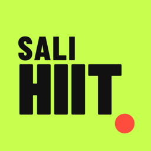
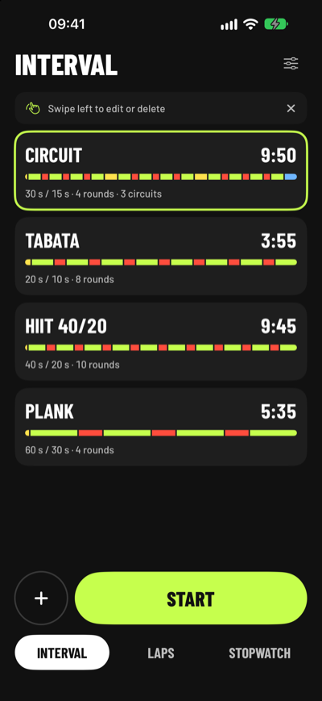
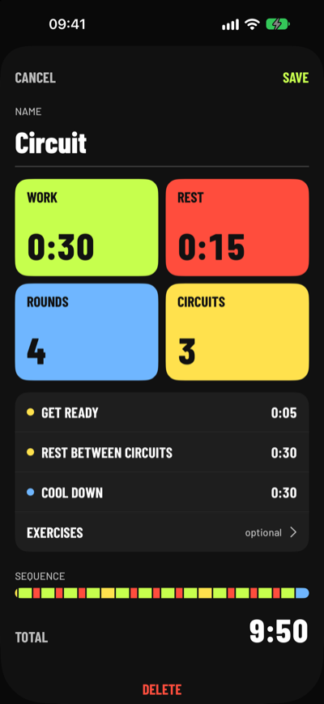
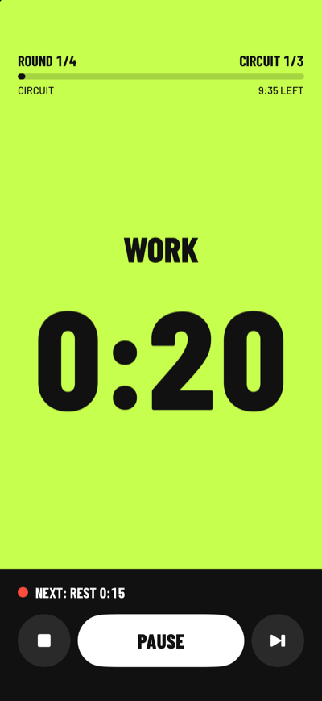
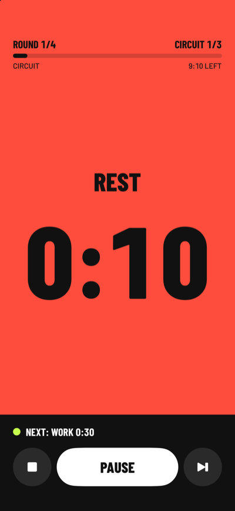
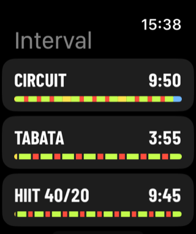
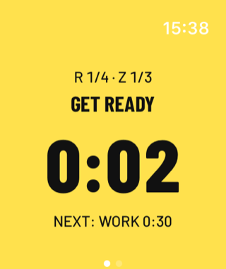
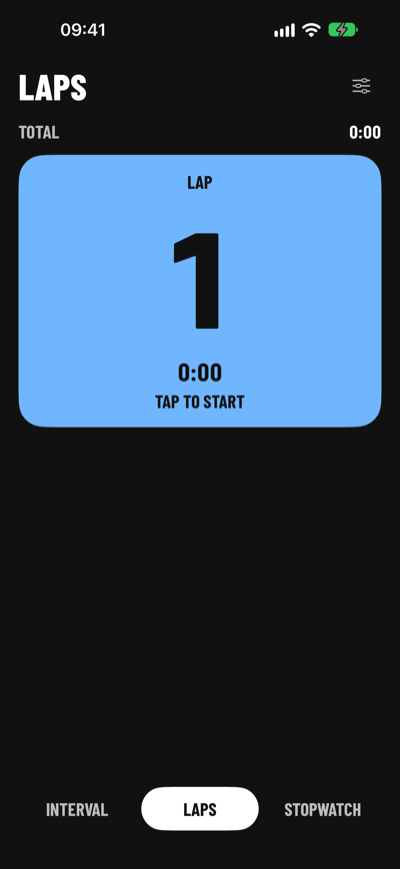
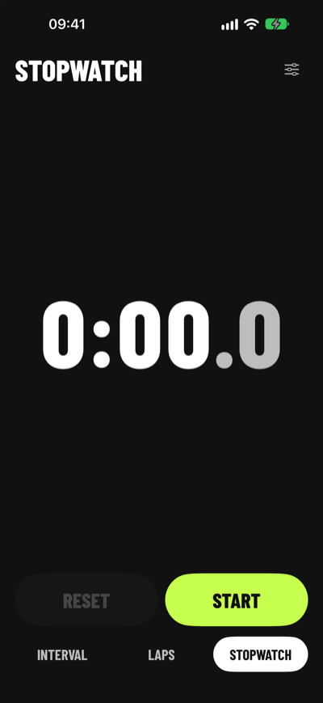

<p align="center">
  
</p>

<h1 align="center">SaliHIIT</h1>

<p align="center">
  A Tabata and HIIT interval timer for iPhone and Apple Watch.<br>
  No ads, no subscription, no account, no tracking.
</p>

<p align="center">
  
  
  
  
</p>

<p align="center">
  
  
  
  
</p>
<p align="center">
  
  
  
  
</p>

## Why SaliHIIT?

Many interval timers on the App Store show ads between sets, lock basic features behind a subscription or ship analytics SDKs. SaliHIIT does one job: it tells you when to work and when to rest, on your phone and on your wrist, and stays out of the way otherwise.

## Download

SaliHIIT is not on the App Store yet. Until then you can build it yourself (see [Building](#building)).

## Features

- **Interval workouts** built from preparation, work, rest, rounds, circuits, rest between circuits and cool-down. Optional exercise names per round, announced when they start.
- **Full-screen phase colours** you can read from across the room: yellow get ready, green work, red rest, blue rounds and cool-down.
- **Lap counter** and **stopwatch** as separate modes.
- **Apple Watch app** with the full feature set. Workouts started on the watch are recorded in Apple Health with heart rate and calories.
- **Live Activity and Dynamic Island** with pause, resume and skip buttons, so the workout keeps running on the lock screen.
- **Sounds, haptics and an optional voice coach** that counts down the last seconds. Music from other apps keeps playing and is ducked briefly for each signal. Six voices in German, Turkish and English; see [docs/VOICES.md](docs/VOICES.md) for their license.
- **Six app icons** to choose from in the settings.
- **English, German and Turkish**, following the device language.

## Requirements

| | |
|---|---|
| Xcode | 27 or later |
| iOS | 26.0 or later |
| watchOS | 26.0 or later |
| [XcodeGen](https://github.com/yonaskolb/XcodeGen) | 2.46 or later |

## Building

The Xcode project is generated from `project.yml` and is not checked in.

```sh
git clone https://github.com/ms-solutions-dev/salihiit.git
cd salihiit
xcodegen generate
open SaliHIIT.xcodeproj
```

Choose the `SaliHIIT` scheme and run it on a simulator. To run it on your own devices, set your development team and change the bundle identifiers (`dev.ms-solutions.salihiit…`) and the app group in `project.yml`, then generate the project again.

Each package under `Packages/` has its own tests:

```sh
swift test --package-path Packages/Core
```

## Project layout

| Path | Contents |
|---|---|
| `App/` | iPhone app target: entry point, resources, string catalog |
| `Watch/` | Apple Watch app |
| `Widget/` | Live Activity and Dynamic Island |
| `Shared/` | App Intents for pause, resume and skip, used by the app and the Live Activity |
| `Packages/Core` | Templates, phase plan, timekeeper and stopwatch. No UI, no I/O |
| `Packages/Storage` | Saved templates and settings |
| `Packages/Control` | Runs a workout: starting, pausing, skipping, finishing |
| `Packages/Signals` | Sounds, haptics, voice coach and notifications |
| `Packages/Connectivity` | Sync between iPhone and Apple Watch |
| `Packages/Design` | Colours, fonts and shared visual components |
| `Packages/Interface` | The iPhone screens and the Live Activity controller |

## Privacy

SaliHIIT collects nothing. Templates and settings stay on your devices and are only synced between your iPhone and your Apple Watch. Health data is written to Apple Health by the watch and never leaves it otherwise.

## Contributing

Bug reports and pull requests are welcome, see [CONTRIBUTING.md](CONTRIBUTING.md). Before your first pull request is merged, you sign our [Contributor License Agreement](CLA.md) with a one-line comment. You keep the copyright in your work.

**Translations:** all user-facing text lives in `App/Resources/Localizable.xcstrings`. Adding a language is a good first contribution: open the catalog in Xcode, add the language and translate the entries.

## Credits

- [Barlow and Barlow Condensed](https://github.com/jpt/barlow) by Jeremy Tribby, SIL Open Font License 1.1
- [XcodeGen](https://github.com/yonaskolb/XcodeGen) generates the Xcode project

## License

Copyright © 2026 ms-solutions

SaliHIIT is free software: you can redistribute it and/or modify it under the terms of the GNU General Public License as published by the Free Software Foundation, either version 3 of the License, or (at your option) any later version. See [LICENSE](LICENSE).
